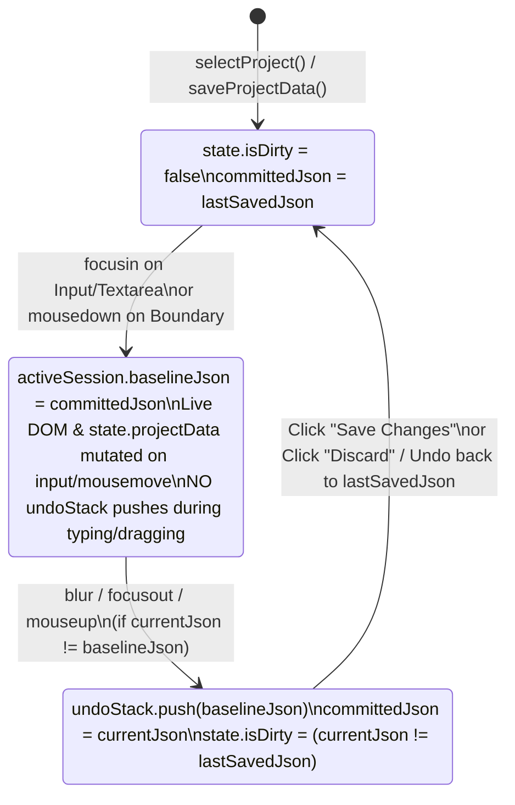

# Specification: Scene Editor Persistence & Undo Granularity (v2 — Post-Critique Blueprint)

**Status:** Implementation-Ready Blueprint (v2, Post-Architectural Critique)  
**Date:** 2026-11-09  
**Target Components:**
- `work/ui/static/js/takes_and_history.js` (Baseline-first Undo/Redo engine, focus-session coordinator, dirty state comparison)
- `work/ui/static/js/state_and_utils.js` (Removal of background auto-save timer, project load history initialization, `Discard Changes` support)
- `work/ui/static/js/scene_inspector.js` (Focus-session delegation for text inputs, discrete change hooks, `<850` line compliance)
- `work/ui/static/js/timeline_and_playback.js`, `markers_and_prompts.js`, `anchors_and_settings.js` (Boundary drag coalescing & discrete mutation coverage)

---

## 0. Critical Flaws Fixed in v2 Critique (Read First)

During a rigorous code-level audit of the v1 draft spec against the live frontend (`takes_and_history.js`, `scene_inspector.js`, `state_and_utils.js`, `timeline_and_playback.js`), **7 critical architectural defects** were identified and resolved in this v2 specification:

1. **CRITICAL — Pre-Mutation vs. Post-Mutation Snapshot Inversion Fixed:**
   - *Flaw in v1 & current code:* `scene_inspector.js` mutates `sc.prompt = e.target.value` **before** calling `recordHistorySnapshot()`. Consequently, `undoStack` was storing *post-mutation* states instead of *pre-mutation* baselines. Undoing the first edit after project load was a no-op (restoring the post-edit state onto itself) and permanently lost the original loaded state. Worse, v1's `commitTextEditSession()` recorded the snapshot on `blur` *after* `sc.prompt` was already mutated, meaning Undo would have restored the newly typed text instead of the pre-focus text!
   - *v2 Fix:* History tracking now maintains a `committedJson` baseline initialized on `selectProject()`. When a typing session or discrete edit occurs, the **pre-mutation baseline (`committedJson`)** is pushed to `undoStack`, and `committedJson` is updated to the new state.

2. **CRITICAL — Removed Silent Auto-Save Inside `performUndo()` and `performRedo()`:**
   - *Flaw in v1:* `takes_and_history.js` (lines 88 & 128) silently called `await window.saveProjectData(false)` on every Undo and Redo. Pressing `Ctrl+Z` immediately overwrote `all_or_nothing_v4.json` on disk, spammed timestamped files in `backup/`, and cleared the dirty indicator even when the user had not clicked Save.
   - *v2 Fix:* `performUndo()` and `performRedo()` no longer save to disk. Instead, the engine tracks `lastSavedJson` (updated only on project load and explicit `saveProjectData`). After any edit, Undo, or Redo, `state.isDirty` is computed dynamically as `currentJson !== lastSavedJson`. If the user undoes all changes back to the last saved state, the `"💾 Save Changes *"` badge automatically clears!

3. **CRITICAL — Eliminated the 1,500ms Idle Timer Inside Focused Text Boxes:**
   - *Flaw in v1:* v1 proposed a 1.5s debounce timer (`noteTextEditInput`) that committed a new undo snapshot every time the user paused typing for 1.5 seconds. When writing multi-shot prompts, users naturally pause for several seconds to think or check timestamps—which would still split a single text-box visit into 10+ undo steps.
   - *v2 Fix:* Strictly honor the user requirement: *"undo all the typing in that text box since I clicked into it."* A text editing session begins on `focusin` and commits **only** when the field loses focus (`blur`), when switching scenes/tabs, or before executing an explicit action button (`Undo`, `Save`, `Render`). Pausing to think while the cursor remains in the box never fragments the undo step.

4. **CRITICAL — Unified `Ctrl+Z` / `↶ Undo` Behavior for Uncommitted Typing Sessions:**
   - *Flaw in v1:* `takes_and_history.js` (line 146) ignored `Ctrl+Z` whenever `document.activeElement` was an `INPUT` or `TEXTAREA`, delegating to browser-native undo (which operates word/character-by-character and desynchronizes when `.value` is populated by `selectScene()`). Meanwhile, clicking the UI `↶ Undo` button blurred the field first.
   - *v2 Fix:* Whether the user presses `Ctrl+Z` while still focused inside a text box **or** clicks the transport `↶ Undo` button (`#btnTimelineUndo`), if the focused field has uncommitted edits since `focusin`, the session is immediately finalized and undone in one step—restoring the exact text that existed when the user clicked into the box (and pushing the typed text to `redoStack` so `Ctrl+Y` / `↷ Redo` can bring it right back).

5. **CRITICAL — Full Coverage of Non-Inspector Mutations & Timeline Boundary Dragging:**
   - *Flaw in v1:* Simply removing `recordHistorySnapshot()` from `markProjectDirty()` orphaned every other mutation in the app that relied on `markProjectDirty()`:
     - Dragging a scene boundary on the timeline canvas (`timeline_and_playback.js` line 556) calls `updateSceneEnd()` on every `mousemove` pixel (previously pushing 60 snapshots/second; under v1, pushing 0 snapshots).
     - Adding, deleting, or splitting a scene, snapping to markers, editing markers (`markers_and_prompts.js`), and editing project settings (`anchors_and_settings.js`).
   - *v2 Fix:* Provide a unified two-method API on `window`:
     - `beginEditSession(sessionKey, desc)` / `commitEditSession()` for continuous interactions (text box typing from `focusin` to `blur`, and timeline boundary dragging from `mousedown` to `mouseup`).
     - `recordProjectChange(desc)` for discrete atomic actions (select dropdowns, nudge buttons, random seed, add/split/delete scene, marker edits, reference chip clicks).

6. **CRITICAL — Strict `<850` Line Modularity Guardrail (`scene_inspector.js` is at 846 lines):**
   - *Flaw in v1:* Adding 45+ lines of session management directly into `scene_inspector.js` (currently 846 lines) would violate the `<850` line limit in `AGENTS.md`.
   - *v2 Fix:* House the entire session & baseline state machine in `work/ui/static/js/takes_and_history.js` (currently 558 lines), and refactor `scene_inspector.js` event binding into a compact table-driven loop so `scene_inspector.js` drops *below* 835 lines.

7. **UX Enhancement — Explicit `"Discard Unsaved"` Action & Unsaved Navigation Guard:**
   - Because edits now live purely in memory until **"💾 Save Changes"** is clicked, users need a one-click way to abandon experimental edits without pressing Undo repeatedly, as well as protection against accidental tab closure when `state.isDirty` is true.

---

## 1. Executive Summary & Problem Statement

Users authoring and refining scene prompts and properties in the Music Video Generation Studio face two related workflow issues:

1. **Unintended Background Auto-Saving**:
   Changes typed into a scene's prompt, timing, or seed are silently saved to disk (`all_or_nothing_v4.json`) 500ms after typing when the console pane is active, and immediately upon every Undo/Redo action, rather than waiting for the user to click **"💾 Save Changes"**.

2. **Letter-by-Letter Undo Granularity**:
   Because every `input` keystroke calls `markProjectDirty()` -> `recordHistorySnapshot()`, typing a 50-character sentence pushes 50 full-project snapshots onto `undoStack`, wiping out prior history (`MAX_HISTORY = 50`) and forcing the user to click Undo 50 times to revert a single sentence.

---

## 2. Core State Machine Architecture

### 2.1 Three-State JSON Tracking in `takes_and_history.js`

To guarantee both **pre-mutation undo accuracy** and **true dirty-state detection**, `takes_and_history.js` maintains two canonical serialized strings alongside `undoStack` and `redoStack`:

- `lastSavedJson`: The exact `JSON.stringify(state.projectData)` last loaded from disk (`selectProject`) or written to disk (`saveProjectData`).
- `committedJson`: The `JSON.stringify(state.projectData)` representing the current committed undo baseline.
- `activeSession`: `{ key, desc, baselineJson } | null` — tracks an in-progress continuous interaction (such as typing inside a focused field or dragging a timeline boundary).



### 2.2 How Focus-Session Coalescing Works Step-by-Step

Suppose Scene `S10` starts with prompt `"Original prompt"`.
1. **Project Load (`selectProject`)**:
   - `lastSavedJson = committedJson = JSON.stringify(state.projectData)` (contains `"Original prompt"`).
   - `undoStack = []`, `redoStack = []`, `state.isDirty = false`.
2. **User Clicks Into `#scenePrompt` (`focusin`)**:
   - `beginEditSession("field:scenePrompt", "Edit Scene S10 Prompt")` is called.
   - `activeSession = { key: "field:scenePrompt", desc: "Edit Scene S10 Prompt", baselineJson: committedJson }`.
3. **User Types 80 Characters (`input` events)**:
   - On each keystroke, `sc.prompt` updates in memory, the textarea auto-resizes, and `syncProjectDirtyState()` sees `currentJson !== lastSavedJson` -> illuminates `"💾 Save Changes *"`.
   - **Zero snapshots are pushed to `undoStack`** while the user types or pauses to think.
   - **Zero HTTP `PUT` requests** are sent to the server.
4. **Case A — User Clicks Outside the Text Box (`blur`) and Then Presses Undo**:
   - On `blur`: `commitEditSession()` compares `currentJson` (contains the 80 new characters) against `activeSession.baselineJson` (contains `"Original prompt"`).
   - Because they differ, it pushes `{ desc: "Edit Scene S10 Prompt", data: JSON.parse(baselineJson) }` onto `undoStack`, updates `committedJson = currentJson`, and clears `activeSession`.
   - When the user clicks `↶ Undo` (or presses `Ctrl+Z`): `performUndo()` pops `"Original prompt"` from `undoStack`, pushes the 80-character state onto `redoStack`, restores `state.projectData` to `"Original prompt"`, refreshes the inspector UI, and updates `state.isDirty` (`false`, since it matches `lastSavedJson` again!).
5. **Case B — User Presses `Ctrl+Z` (or Clicks `↶ Undo`) While Still Focused Inside the Text Box**:
   - `performUndo()` first calls `commitEditSession()`.
   - `commitEditSession()` commits the in-progress typing session (`baselineJson` -> `undoStack`).
   - `performUndo()` immediately pops that snapshot, restoring `"Original prompt"` in one step and placing the typed text onto `redoStack`!

---

## 3. Detailed Implementation Blueprint

### 3.1 `work/ui/static/js/takes_and_history.js`

Replace the naive Tier 1 history block (lines 16–166) with the Baseline-First Session History Engine:

```javascript
  const MAX_HISTORY = 50;
  const undoStack = [];
  const redoStack = [];
  let isApplyingHistory = false;
  let lastSavedJson = null;
  let committedJson = null;
  let activeSession = null;

  function initProjectHistory() {
    if (!window.state || !window.state.projectData) return;
    const snap = JSON.stringify(window.state.projectData);
    lastSavedJson = snap;
    committedJson = snap;
    activeSession = null;
    undoStack.length = 0;
    redoStack.length = 0;
    updateHistoryButtons();
    if (typeof window.markProjectDirty === "function") {
      window.markProjectDirty(false);
    }
  }

  function markHistorySaved() {
    if (!window.state || !window.state.projectData) return;
    commitEditSession();
    lastSavedJson = JSON.stringify(window.state.projectData);
    committedJson = lastSavedJson;
    if (typeof window.markProjectDirty === "function") {
      window.markProjectDirty(false);
    }
  }

  function syncDirtyWithSavedState() {
    if (!window.state || !window.state.projectData) return;
    const currentJson = JSON.stringify(window.state.projectData);
    const isDirty = lastSavedJson !== null ? currentJson !== lastSavedJson : true;
    if (typeof window.markProjectDirty === "function") {
      window.markProjectDirty(isDirty);
    }
  }

  function beginEditSession(sessionKey, desc = "Edit") {
    if (isApplyingHistory || !window.state || !window.state.projectData) return;
    if (activeSession && activeSession.key === sessionKey) {
      if (desc) activeSession.desc = desc;
      return;
    }
    commitEditSession();
    if (committedJson === null) {
      committedJson = JSON.stringify(window.state.projectData);
    }
    activeSession = {
      key: sessionKey,
      desc: desc,
      baselineJson: committedJson,
    };
  }

  function commitEditSession() {
    if (!activeSession || isApplyingHistory || !window.state || !window.state.projectData) {
      activeSession = null;
      return;
    }
    const { desc, baselineJson } = activeSession;
    activeSession = null;

    const currentJson = JSON.stringify(window.state.projectData);
    if (currentJson === baselineJson) return;

    if (undoStack.length >= MAX_HISTORY) {
      undoStack.shift();
    }
    undoStack.push({
      desc: desc || "Edit",
      time: Date.now(),
      data: JSON.parse(baselineJson),
    });
    committedJson = currentJson;
    redoStack.length = 0;
    updateHistoryButtons();
    syncDirtyWithSavedState();
  }

  function recordHistorySnapshot(desc = "Edit") {
    if (isApplyingHistory || !window.state || !window.state.projectData) return;
    // If an active typing/drag session is open, flush it first
    if (activeSession) {
      commitEditSession();
    }
    try {
      const currentJson = JSON.stringify(window.state.projectData);
      if (committedJson === null) {
        committedJson = currentJson;
        return;
      }
      if (currentJson === committedJson) {
        syncDirtyWithSavedState();
        return;
      }

      if (undoStack.length >= MAX_HISTORY) {
        undoStack.shift();
      }
      undoStack.push({
        desc: desc,
        time: Date.now(),
        data: JSON.parse(committedJson),
      });

      committedJson = currentJson;
      redoStack.length = 0;
      updateHistoryButtons();
      syncDirtyWithSavedState();
    } catch (err) {
      console.warn("[History] Failed to record snapshot:", err);
    }
  }
```

#### Updated `performUndo()`, `performRedo()`, and `discardUnsavedChanges()`:
- In `performUndo()`:
  1. Call `commitEditSession()` first so any active typing in a focused text box is committed as a single unit before popping.
  2. Pop `snapshot` from `undoStack`, push `JSON.parse(currentJson)` onto `redoStack`, and restore `window.state.projectData = JSON.parse(JSON.stringify(snapshot.data))`.
  3. Update `committedJson = JSON.stringify(window.state.projectData)`.
  4. Re-render UI (`redrawTimeline()`, `updateProjectSettingsUI()`, `selectScene(state.selectedSceneIdx)`).
  5. Call `syncDirtyWithSavedState()` — **do NOT call `saveProjectData(false)`**.
- In `discardUnsavedChanges()`:
  1. If `!lastSavedJson` or `!state.isDirty`, return.
  2. Call `commitEditSession()`.
  3. Push current state onto `undoStack` with `desc = "Discard Unsaved Changes"` (so even a Discard can be undone with `Ctrl+Z`!).
  4. Restore `window.state.projectData = JSON.parse(lastSavedJson)` and `committedJson = lastSavedJson`.
  5. Refresh UI and call `syncDirtyWithSavedState()`.
- In Global Hotkeys (`keydown`):
  - Intercept `(e.ctrlKey || e.metaKey) && e.key.toLowerCase() === "z"` and `"y"` globally (including when focused inside inspector inputs/textareas, so `Ctrl+Z` undoes the entire typing session since clicking into the box rather than single letters).
  - Also bind `(e.ctrlKey || e.metaKey) && e.key.toLowerCase() === "s"` to `e.preventDefault(); saveProjectData(true);` for convenient keyboard saving!

---

### 3.2 `work/ui/static/js/state_and_utils.js`

1. **In `selectProject(slug, configFile)`**:
   After `state.projectData = json.data;`, call `if (typeof window.initProjectHistory === "function") window.initProjectHistory();`.
2. **In `markProjectDirty(dirty = true)`**:
   - Remove `dirtyQueueSyncTimer` and the 500ms `saveProjectData(false)` auto-save block completely.
   - Remove the automatic `window.recordHistorySnapshot("Edit Project")` call from `markProjectDirty()`, replacing it with a non-recording check or delegating to explicit session/discrete hooks.
   - Toggle visibility of an optional `#btnDiscardChanges` button next to `#btnSaveProject` when `dirty === true`.
3. **Add `beforeunload` Guard**:
   ```javascript
   window.addEventListener("beforeunload", (e) => {
     if (state.isDirty && !state._savingProject) {
       e.preventDefault();
       e.returnValue = "";
     }
   });
   ```

---

### 3.3 `work/ui/static/js/scene_inspector.js` (Keeping `<850` Lines)

1. **Flush active typing session when switching scenes**:
   At the top of `selectScene(idx)`:
   ```javascript
   if (typeof window.commitEditSession === "function") window.commitEditSession();
   ```
2. **Separate Text/Number Inputs from Select Dropdowns (Lines 455–527)**:
   - **Text & Number Inputs** (`scenePrompt`, `scenePromptM`, `scenePromptF`, `sceneStart`, `sceneEnd`, `sceneSeed`, `sceneSeedM`, `sceneSeedF`, `sceneSplitX`):
     - On `focus`: `window.beginEditSession?.("inspector:" + id, "Edit " + (sc?.id || "Scene") + " " + labelMap[id])`.
     - On `input`: mutate `sc[prop]` in memory, update live UI (`autoResizeTextarea`, `redrawTimeline`), and call `markProjectDirty(true)`. **Do not push history.**
     - On `blur`: `window.commitEditSession?.()`.
   - **Discrete Select Dropdowns** (`sceneMode`, `sceneAnchor`, `sceneVideoRenderer`, `sceneStem`, `sceneStemM`, `sceneStemF`):
     - On `change`: apply change to `sc` and immediately call `window.recordHistorySnapshot?.("Change " + sc.id + " " + labelMap[id])`.
3. **Discrete Action Buttons**:
   - `nudgeTiming`, `btnSnapStartMarker`, `btnSnapEndMarker`, `btnRandomSeed*`, `btnAddScene`, `deleteScene`, `splitScene`:
     Call `window.recordHistorySnapshot?.(desc)` right after applying the mutation.

---

### 3.4 `work/ui/static/js/timeline_and_playback.js`, `markers_and_prompts.js`, `anchors_and_settings.js`

1. **Timeline Boundary Dragging (`timeline_and_playback.js`)**:
   - On `mousedown` when `boundaryIdx !== null`:
     Call `window.beginEditSession?.("boundary:" + boundaryIdx, "Drag Scene Boundary")`.
   - On `mousemove` while `state.isDraggingBoundary`:
     `updateSceneEnd()` updates `sc.end` and `nextSc.start` and calls `markProjectDirty(true)` without pushing per-pixel snapshots.
   - On `mouseup` when `state.isDraggingBoundary`:
     Call `window.commitEditSession?.()` to record the entire drag as a single undo step.
2. **Markers (`markers_and_prompts.js`)**:
   - Call `recordHistorySnapshot("Add Marker")`, `recordHistorySnapshot("Edit Marker")`, `recordHistorySnapshot("Delete Marker")` in `addMarkerAtTime`, `btnSaveMarker`, and `btnDeleteMarker`.
   - In `insertMarkerTagIntoPrompt(tag)`: wrap the programmatic insertion in `beginEditSession` / `commitEditSession` so clicking `+ Tag (s)` is a clean undo step.
3. **Project Settings & Save (`anchors_and_settings.js`)**:
   - Bind `focus` / `blur` session hooks on settings text/number inputs (`cfgProjectName`, `cfgMasterAudio`, `cfgFps`, `cfgFadeOut`, `cfgRenderOverlap`, `cfgNegativePrompt`) and `change` hooks on default renderer selects and resolution cards.
   - Inside `saveProjectData()`, after `res` succeeds (`json.success`), call `window.markHistorySaved?.()`.

---

## 4. End-to-End Verification & Test Journeys

### Journey 1: Strict Explicit Save (No Save-While-Typing or Save-On-Undo)
1. Open project in UI and open the Render Console tab (`#tab-console.active`).
2. Select scene `S10` and type `"Draft text"` into `#scenePrompt`.
3. Wait 2 seconds.
   - **Verify:** `all_or_nothing_v4.json` on disk is **unchanged**. `#btnSaveProject` displays `"💾 Save Changes *"`.
4. Press `Ctrl+Z` (or click `↶ Undo`).
   - **Verify:** Prompt reverts to original text, NO `PUT /api/project/...` request is fired, and `#btnSaveProject` returns to `"💾 Save Changes"` (clean state, because memory matches disk again).

### Journey 2: Full-Session Text Box Undo (While Focused and After Blur)
1. Select scene `S10` (original prompt $P_0$).
2. Click into `#scenePrompt`. Type `"First phrase..."`, pause 3 seconds to think, then type `"Second phrase..."` (total 50+ characters, resulting in $P_1$).
3. Press `Ctrl+Z` (or click `↶ Undo`).
   - **Verify:** In **one single step**, all typing since clicking into `#scenePrompt` is undone, restoring $P_0$ completely.
4. Press `Ctrl+Y` (or click `↷ Redo`).
   - **Verify:** In **one single step**, $P_1$ is restored completely.

### Journey 3: Multi-Action History Stack Preservation & Boundary Drag Coalescing
1. Drag scene `S01` end boundary from `6.8s` to `7.5s` across 30 mousemove events.
2. Click `#btnRandomSeed` on `S02`.
3. Click into `S03` prompt and type a 100-character sentence, then click outside.
4. Click `↶ Undo` three times:
   - **Undo 1:** Reverts the 100-character sentence in `S03` to its pre-focus prompt.
   - **Undo 2:** Reverts `S02` seed to its previous value.
   - **Undo 3:** Reverts `S01` boundary from `7.5s` back to `6.8s` in one jump.

---

## 5. Modularity & File Size Budget

| File | Current Lines | Projected Lines | Limit |
| :--- | :--- | :--- | :--- |
| `work/ui/static/js/takes_and_history.js` | 558 | ~640 | `< 850` |
| `work/ui/static/js/scene_inspector.js` | 846 | ~815 *(refactored bindings)* | `< 850` |
| `work/ui/static/js/state_and_utils.js` | 403 | ~405 | `< 850` |
| `work/ui/static/js/timeline_and_playback.js` | 844 | ~846 -> ~835 *(trimmed)* | `< 850` |
| `work/ui/static/js/markers_and_prompts.js` | 237 | ~245 | `< 850` |
| `work/ui/static/js/anchors_and_settings.js` | 451 | ~465 | `< 850` |
