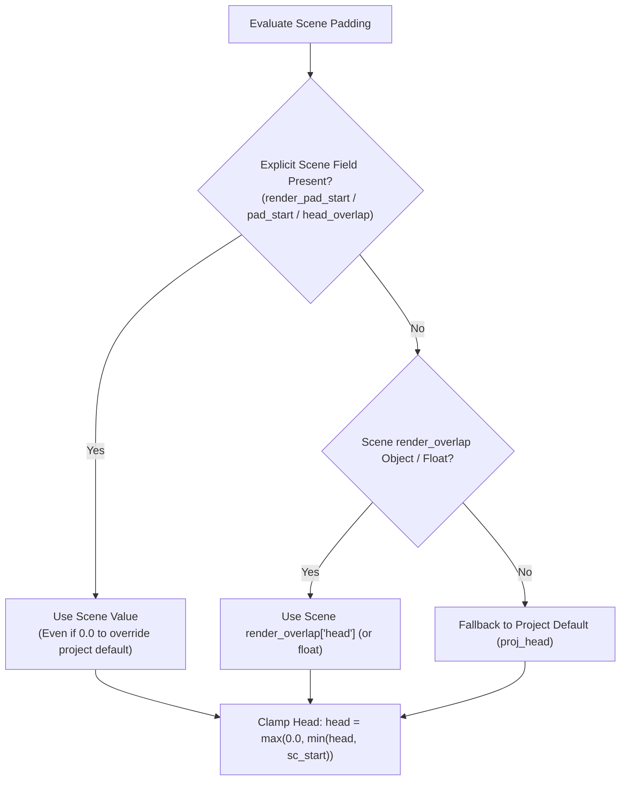

# Specification: Scene-Level Render Padding & Overlap (`render_pad_start` / `render_pad_end`)

**Document Version:** 1.1.0  
**Status:** Reviewed & Hardened — Ready for Implementation  
**Target:** Music Video Generation Studio (Backend Pipeline, Fast Queue, Master Assembly, Takes Vault, CLI & Web UI)

---

## 1. Executive Summary & Problem Statement

### 1.1 The Problem: Abrupt Audio Cuts & Vocal Lip-Sync Latching
Audio-conditioned diffusion models (such as MiniMax H3 FL2VA, Wan2.1, and DiT-based video generators) rely on temporal attention across the audio waveform to align character mouth phonemes, head movements, and musical cadence:
1. **Slow Vocal Latching on Hard Attacks:** When a scene starts right where a singer belts out a word, an audio slice trimmed exactly to the timeline cut point starts abruptly (often mid-transient or without preceding breath/consonant attack). The diffusion model frequently takes 10–25 frames (0.4s–1.0s) to "latch on" to the vocal stem, resulting in characters staring blankly with closed mouths during the opening beats of their line before suddenly snapping into lip-sync.
2. **Abrupt Scene Cut-Offs at Tails:** Conversely, when a scene cut point slices audio right at the end of a phrase, the sudden drop to silence can leave the character frozen with their mouth half-open, or cause sudden diffusion warping at the clip's final frames.
3. **Imprecision of Global-Only Setting:** The studio currently offers a project-level setting (`render_overlap_seconds` in `project.json`). However, applying uniform padding globally is suboptimal:
   * **Opening scene (S01):** Cannot render before `0.00s`.
   * **Fast montage / instrumental cuts:** Extra padding adds unnecessary GPU rendering time for scenes that do not need vocal pre-roll.
   * **End-Anchored Seamless Cuts (`anchor_end`):** Scenes using `image_prompt_type="SE"` need `<Picture 2>` to land on the exact cut frame (`tail_pad = 0.0s`), while still benefiting from pre-roll (`head_pad > 0.0s`).
   * **Vocal Showcase Scenes (e.g. S02, S10, S13):** Need targeted pre-roll (e.g. `1.0s`–`1.5s`) and/or post-roll (`0.5s`–`1.0s`) to allow natural breathing and phrase decay across the edit cut points.

### 1.2 The Solution
Allow **per-scene render padding overrides** (`render_pad_start` and `render_pad_end`) in addition to the project-level default:
* **`render_pad_start` (Head Handle / Pre-Roll):** Additional seconds rendered **before** the scene's timeline `start`. The video generator renders pre-roll audio so the character is already naturally moving and lip-syncing when the timeline edit point arrives.
* **`render_pad_end` (Tail Handle / Post-Roll):** Additional seconds rendered **after** the scene's timeline `end`. The video generator captures natural phrase decay and mouth closure.
* **Master Stitching Integration (`stage3_master.py`):** When assembling the master video, ffmpeg automatically trims away the pre-roll (`head_offset_s = sc_start - render_start`) and post-roll, stitching only the exact timeline edit duration with zero cumulative timing drift.

---

## 2. Architecture & Data Model

### 2.1 Scene Configuration Schema (`projects/<slug>/*.json`)

Each scene dictionary in `scenes` supports optional head and tail padding overrides:

```json
{
  "id": "S10",
  "start": 66.30,
  "end": 74.50,
  "mode": "solo",
  "anchor": "A05 - Pianist_2K.jpg",
  "renderer": 1,
  "seed": 1000,
  "stem": "male",
  "render_pad_start": 1.5,
  "render_pad_end": 0.8,
  "prompt": "For the target video, at 0.00 seconds into the target video, <Picture 1> is fully referenced..."
}
```

### 2.2 Property Definitions & Aliases

| Property | Type | Description |
|---|---|---|
| `render_pad_start` | `float \| null` | Canonical pre-roll padding in seconds rendered before `start`. Accepted read aliases: `pad_start`, `head_overlap`. |
| `render_pad_end` | `float \| null` | Canonical post-roll padding in seconds rendered after `end`. Accepted read aliases: `pad_end`, `tail_overlap`. |
| `render_overlap` | `float \| dict \| null` | Optional shorthand object `{"head": 1.5, "tail": 0.8}` or single float `1.0` (applied to both head and tail). Accepted alias: `render_overlap_seconds`. |

### 2.3 Three-Tier Resolution Hierarchy & Clamping Rules

Padding resolution follows a deterministic cascade implemented in a pure helper function `resolve_scene_padding(sc, proj_head=0.0, proj_tail=0.0)`:



> [!IMPORTANT]
> 1. **Explicit Zero (`0.0`) Must Override Project Default:** If `project.render_overlap_seconds` is `1.0`, setting `"render_pad_start": 0.0` on a scene must disable pre-roll for that scene. Checks must test `if sc.get(k) is not None:` rather than truthiness.
> 2. **Song Start Clamping:** Pre-roll cannot sample before `0.00s` in the master audio. Therefore `head` is always clamped to `max(0.0, min(head, float(sc.get("start", 0.0))))`.
> 3. **End Anchor (`anchor_end`) Tail Default:** When `sc.get("anchor_end")` is set, MiniMax H3 `image_prompt_type="SE"` conditions the **final frame** of the generated clip on `<Picture 2>`. If `render_pad_end` is not explicitly set on the scene, `tail` defaults to `0.0` (ignoring `proj_tail`) so project-wide overlap does not push `<Picture 2>` past the cut point where `stage3_master.py` would trim it off.

---

## 3. Component Touchpoints & Implementation Requirements

> [!CAUTION]
> **Strict 850-Line Module Limit Guardrail:**
> Several target files are currently close to the 850-line repository limit:
> * `work/pipeline/takes.py`: **845 lines**
> * `work/ui/server_queue.py`: **843 lines**
> * `work/ui/static/js/scene_inspector.js`: **842 lines**
> * `work/ui/static/js/timeline_and_playback.js`: **837 lines**
> * `work/pipeline/context.py`: **804 lines**
>
> Follow the compact implementation patterns specified below (and condense adjacent multi-line statements where indicated) so **every modified file remains strictly `< 850` lines**.

### 3.1 Pipeline Context (`work/pipeline/context.py` & `work/run_overnight_v3.py`)

1. **Standalone Helper `resolve_scene_padding` & Method `ProjectContext.get_scene_render_padding`:**
   Add `resolve_scene_padding` in `work/pipeline/context.py` (and re-export in `work/pipeline/__init__.py` and `work/run_overnight_v3.py`):
   ```python
   def resolve_scene_padding(sc: dict | None, proj_head: float = 0.0, proj_tail: float = 0.0) -> tuple[float, float]:
       """Resolves (head_pad_s, tail_pad_s) following scene-override -> project-default hierarchy."""
       if not isinstance(sc, dict):
           return max(0.0, float(proj_head or 0.0)), max(0.0, float(proj_tail or 0.0))
       ov = sc.get("render_overlap") if sc.get("render_overlap") is not None else sc.get("render_overlap_seconds")
       head = next((float(sc[k]) for k in ("render_pad_start", "pad_start", "head_overlap") if sc.get(k) is not None), None)
       if head is None and ov is not None:
           head = float(ov.get("head", 0.0)) if isinstance(ov, dict) else float(ov)
       if head is None:
           head = float(proj_head or 0.0)

       tail = next((float(sc[k]) for k in ("render_pad_end", "pad_end", "tail_overlap") if sc.get(k) is not None), None)
       if tail is None and ov is not None:
           tail = float(ov.get("tail", 0.0)) if isinstance(ov, dict) else float(ov)
       if tail is None:
           tail = 0.0 if sc.get("anchor_end") else float(proj_tail or 0.0)

       sc_start = max(0.0, float(sc.get("start", 0.0)))
       return round(max(0.0, min(head, sc_start)), 3), round(max(0.0, tail), 3)
   ```
   And on `ProjectContext`:
   ```python
   def get_scene_render_padding(self, sc: dict) -> tuple[float, float]:
       return resolve_scene_padding(sc, self.head_overlap_s, self.tail_overlap_s)
   ```

2. **Audio Slice Cache Correctness (`ProjectContext.slice_audio` in `work/pipeline/context.py` L482–492):**
   * **Do NOT rename `out_wav` (`f"{sid}_{safe_stem_tag}.wav"`)** — `_stem_matches_legacy_render` in `stage2_scenes.py` and `tests/test_backend_queue.py` depend on that exact filename.
   * Currently `slice_audio` skips slicing solely based on `abs(out_wav.stat().st_size - expected_size) < 4000`. If a user shifts `start_s` while `dur_s` stays constant, `slice_audio` would reuse stale audio!
   * **Fix:** Track the slice window in a tiny sidecar `meta = out_wav.with_suffix(".slice")`:
     ```python
     def slice_audio(self, src_audio: Path, start_s: float, dur_s: float, out_wav: Path):
         expected_size = round(dur_s * 176400) + 44
         sig = f"{start_s:.3f}:{dur_s:.3f}"
         meta = out_wav.with_suffix(".slice")
         if out_wav.exists() and abs(out_wav.stat().st_size - expected_size) < 4000:
             if not meta.exists() or meta.read_text(encoding="utf-8").strip() == sig:
                 return
         subprocess.run(
             [
                 str(self.ffmpeg), "-y", "-ss", f"{start_s:.3f}", "-t", f"{dur_s:.3f}",
                 "-i", str(src_audio), "-ar", "44100", "-ac", "2", "-c:a", "pcm_s16le", str(out_wav),
             ],
             check=True, stdout=subprocess.DEVNULL, stderr=subprocess.DEVNULL,
         )
         try:
             meta.write_text(sig, encoding="utf-8")
         except OSError:
             pass
     ```

### 3.2 Task Hashing & Stage 2 Video Rendering (`work/pipeline/stage2_scenes.py`)

1. **`compute_project_task_hashes(ctx, ...)`:**
   * At the top of the `for sc in ctx.scenes:` loop, compute:
     ```python
     head_pad, tail_pad = ctx.get_scene_render_padding(sc)
     default_head, default_tail = resolve_scene_padding({"start": start, "end": end, "anchor_end": sc.get("anchor_end")}, ctx.head_overlap_s, ctx.tail_overlap_s)
     has_custom_pad = (head_pad, tail_pad) != (default_head, default_tail)
     ```
   * In both the solo branch (`req_start = max(0.0, start - head_pad)`) and the two-pass duet branch (`req_start = max(0.0, start - head_pad)`), use `head_pad` instead of `ctx.head_overlap_s`.
   * When `has_custom_pad` is `True`, set `base_payload["pad"] = [head_pad, tail_pad]` (in solo mode) and `p1_base["pad"] = [head_pad, tail_pad]` (in two-pass mode, which automatically cascades into `h_p2`).
   * **Why this rule is critical:**
     * Unmodified scenes (or scenes where the user sets `0.0` when the project default is already `0.0`) do not get a `"pad"` key in `base_payload`, preserving 100% hash compatibility with existing renders.
     * Any scene with non-default padding gets a distinct `task_hash` for each `[head_pad, tail_pad]` pair. This guarantees that **shrinking** padding (e.g. `1.5s` -> `0.5s`) changes `task_hash` and re-renders (or promotes the matching take from the Render Vault), and prevents Takes Vault hash collisions between padded and unpadded renders!

2. **`run_stage2_scenes(...)`:**
   * At the start of `for sc in ctx.scenes:`, resolve:
     ```python
     head_pad, tail_pad = ctx.get_scene_render_padding(sc)
     req_start = max(0.0, start - head_pad)
     req_end = end + tail_pad
     req_dur = req_end - req_start
     ```
   * Use `req_start`, `req_end`, `req_dur` in both solo and two-pass duet branches (replacing `ctx.head_overlap_s` and `ctx.tail_overlap_s`).
   * **Coverage Check Bounds:** Pass `req_start, req_end` (instead of bare `start, end`) to `check_scene_render_coverage`:
     * Solo: `is_covered, rendered_start, rendered_end = check_scene_render_coverage(ctx.ffmpeg, out_mp4, scene_renders, out_name, req_start, req_end)`
     * Two-pass:
       `cov_p1, r_start_p1, r_end_p1 = check_scene_render_coverage(ctx.ffmpeg, mp4_p1, scene_renders, out_p1, req_start, req_end)`
       `cov_p2, r_start_p2, r_end_p2 = check_scene_render_coverage(ctx.ffmpeg, mp4_p2, scene_renders, out_p2, req_start, req_end)`

### 3.3 Fast Queue Evaluation & Clip Metadata (`work/ui/server_queue.py`)

> [!IMPORTANT]
> `work/ui/server_queue.py` is 843 lines. Keep edits net `<= +2` lines so the file stays `< 850` lines.

1. **Import `resolve_scene_padding`:**
   In the top import block (`L15–20`), import `resolve_scene_padding` alongside `derive_split_scene_ids, split_scene_in_project_data, delete_scene_in_project_data`.
2. **Attach `render_start` & `render_end` in `collect_project_clips` (`L131–153`):**
   Load `scene_renders` from `proj_dir / "work" / "jobs_v3" / "state_hashes.json"` (or `work/state_hashes.json`). When building `info` for a clip in `renders` (`"trimmed" not in rel_path.lower()`), if `clip.stem in scene_renders`, attach `"render_start": scene_renders[clip.stem].get("render_start")` and `"render_end": scene_renders[clip.stem].get("render_end")`.
3. **Evaluate Padded Bounds in `_evaluate_pass` (`L356–366`):**
   Replace lines 356–366 with this compact 9-line check:
   ```python
        # Check timeline & render padding bounds coverage
        if sc:
            h_pad, t_pad = ctx.get_scene_render_padding(sc) if ctx else resolve_scene_padding(sc)
            req_s, req_e = max(0.0, float(sc.get("start", 0)) - h_pad), float(sc.get("end", 0)) + t_pad
            r_info = scene_renders.get(out_name)
            if r_info and "render_start" in r_info and "render_end" in r_info:
                if not ((float(r_info["render_start"]) <= req_s + 0.05) and (float(r_info["render_end"]) >= req_e - 0.05)):
                    return "queued", "TIMELINE CHANGED", True, cur_task_hash, cur_anchor_mtime
   ```
   *(Keeping `"TIMELINE CHANGED"` preserves compatibility with existing queue tests asserting `"TIMELINE"` in `reason`.)*

### 3.4 Scene Splitting (`work/pipeline/scene_ops.py`)

In `split_scene_in_project_data` (`work/pipeline/scene_ops.py` L149–152):
* When splitting a scene at `split_time` into `scene1` (head) and `scene2` (tail):
  * `scene1` retains any start padding (`render_pad_start`, `pad_start`, `head_overlap`), and pops any end padding (`for k in ("render_pad_end", "pad_end", "tail_overlap"): scene1.pop(k, None)`).
  * `scene2` retains any end padding (`render_pad_end`, `pad_end`, `tail_overlap`), and pops any start padding (`for k in ("render_pad_start", "pad_start", "head_overlap"): scene2.pop(k, None)`).
  * If `target_scene` used a dict/float `render_overlap`, convert it into `scene1["render_pad_start"]` and `scene2["render_pad_end"]` and pop `render_overlap` from both so the interior cut boundary has `0.0s` padding by default.

### 3.5 Takes Vault & Rollback (`work/pipeline/takes.py` & `work/ui/static/js/takes_and_history.js`)

> [!IMPORTANT]
> `work/pipeline/takes.py` is 845 lines. Condense 2–3 lines in `promote_take_to_active` so the file stays `< 850` lines.

1. **`promote_take_to_active` (`work/pipeline/takes.py` L460–475):**
   * When `pass_num == 1`, include `"render_pad_start"` and `"render_pad_end"` in the restored tuple; if absent from `snap`, pop them from `target_sc`.
   * When `pass_num is None` (full scene take restore), after copying `snap` items, ensure stale padding keys are popped if absent from `snap`:
     ```python
     for pk in ("anchor_end", "render_pad_start", "render_pad_end", "pad_start", "pad_end", "render_overlap"):
         if pk not in snap:
             target_sc.pop(pk, None)
     ```
2. **Frontend Take Activation & Diff (`work/ui/static/js/takes_and_history.js` L445–448 & L540–545):**
   * In `btnRestore.onclick`:
     ```javascript
     if (restored.render_pad_start !== undefined) scene.render_pad_start = restored.render_pad_start;
     else delete scene.render_pad_start;
     if (restored.render_pad_end !== undefined) scene.render_pad_end = restored.render_pad_end;
     else delete scene.render_pad_end;
     ```
   * In `renderSelectedTakeState`: compare `chosenTake.scene_snapshot?.render_pad_start ?? ""` against `scene.render_pad_start ?? ""` (and `render_pad_end`) and push `Pad: +${snapPadStart || 0}s / +${snapPadEnd || 0}s` to `diffs` when different.

### 3.6 CLI Operations (`.agents/skills/` & `.claude/skills/mvg-project-ops/scripts/project_tool.py`)

Keep both `.agents/skills/mvg-project-ops/scripts/project_tool.py` and `.claude/skills/mvg-project-ops/scripts/project_tool.py` 100% identical:
1. **`show-scene`:**
   * If `render_pad_start` or `render_pad_end` is set on `scene`, print:
     `print(f"  Padding  : Head +{scene.get('render_pad_start', 0.0)}s | Tail +{scene.get('render_pad_end', 0.0)}s")`
2. **`set-scene`:**
   * Add `--pad-start` and `--pad-end` arguments (accepting float or `"none"`/`"clear"`/`"default"`):
     * If `"none"`/`"clear"`/`"default"`/`""`: `scene.pop("render_pad_start", None)` (or `render_pad_end`).
     * Else: `val = float(args.pad_start)` (raise/exit with error if `< 0`), and set `scene["render_pad_start"] = val`.
3. **`audit`:**
   * For each scene, check `render_pad_start` and `render_pad_end` if present:
     * Warn if `< 0`.
     * Warn if `float(s.get("start", 0)) - float(s["render_pad_start"]) < -0.001` (`f"Scene {sid} render_pad_start ({s['render_pad_start']}s) exceeds scene start ({s.get('start', 0)}s); will clamp to 0.0s"`).
     * Warn if `s.get("anchor_end")` and `float(s.get("render_pad_end") or 0) > 0` (`f"Scene {sid} sets both anchor_end and render_pad_end ({s['render_pad_end']}s); end anchor frame will be trimmed in master"`).

### 3.7 Studio Web UI (`index.html`, `scene_inspector.js`, `markers_and_prompts.js`, `timeline_and_playback.js`)

1. **`work/ui/static/index.html` (`L150–153`):**
   Add Head Pad and Tail Pad controls right after the `End (s)` form-group in `#sceneInspectorForm`:
   ```html
   <div class="form-group" id="sceneRenderPaddingGroup">
     <label style="display: flex; justify-content: space-between; align-items: center;">
       <span title="Render extra pre-roll/post-roll audio handles so vocal lip-sync latches cleanly across cuts. Trimmed automatically in master assembly.">Render Padding (Pre / Post-Roll s)</span>
       <span id="btnResetScenePadding" style="font-size: 11px; color: #ef4444; cursor: pointer; display: none;">Clear</span>
     </label>
     <div style="display: flex; gap: 6px; align-items: center;">
       <span style="font-size: 11px; color: var(--text-muted);">Head</span>
       <input type="number" id="scenePadStart" step="0.1" min="0" max="10" placeholder="Def" style="flex: 1; min-width: 50px;" title="Seconds to render BEFORE Scene Start (pre-roll)">
       <span style="font-size: 11px; color: var(--text-muted);">Tail</span>
       <input type="number" id="scenePadEnd" step="0.1" min="0" max="10" placeholder="Def" style="flex: 1; min-width: 50px;" title="Seconds to render AFTER Scene End (post-roll)">
     </div>
   </div>
   ```

2. **`work/ui/static/js/scene_inspector.js` (Currently 842 lines — keep `< 850` lines!):**
   * In `selectScene(idx)` (`L260`): populate `scenePadStart` and `scenePadEnd` values (`sc.render_pad_start ?? ""`, `sc.render_pad_end ?? ""`), set placeholders (`Def (${state.projectData?.project?.render_overlap_seconds ?? 0}s)`), and toggle `#btnResetScenePadding` visibility (`(sc.render_pad_start !== undefined || sc.render_pad_end !== undefined) ? "inline" : "none"`).
   * In `textInputLabels` (`L451–461`): add `scenePadStart: "Head Padding"` and `scenePadEnd: "Tail Padding"`.
   * In the `input` listener (`L482–494`):
     ```javascript
     else if (id === "scenePadStart" || id === "scenePadEnd") {
       const prop = id === "scenePadStart" ? "render_pad_start" : "render_pad_end";
       if (val === "" || val === null) delete sc[prop];
       else sc[prop] = Math.max(0, parseFloat(val) || 0);
       const btnR = document.getElementById("btnResetScenePadding");
       if (btnR) btnR.style.display = (sc.render_pad_start !== undefined || sc.render_pad_end !== undefined) ? "inline" : "none";
       updateSceneMarkersBar(sc); updatePromptResolvedPreviews(sc);
     }
     ```
   * Wire `#btnResetScenePadding` click to `delete sc.render_pad_start; delete sc.render_pad_end;`, clear both inputs, hide the button, refresh markers/previews, `markProjectDirty(); redrawTimeline();`, and record a history snapshot.
   * In `splitScene(idx)` (`L810`): `delete scene1.render_pad_end; delete scene2.render_pad_start;`.
   * *Line-saving tip for `scene_inspector.js`:* Condense single-statement `if` blocks in `deleteScene` or `updateSceneStart`/`updateSceneEnd` so total lines remain `<= 845`.

3. **`work/ui/static/js/markers_and_prompts.js` (`L160–196`):**
   * In `updateSceneMarkersBar(sc)`: compute effective `headPad = sc.render_pad_start !== undefined ? Number(sc.render_pad_start) : Number(state.projectData?.project?.render_overlap_seconds || 0)` and `reqStart = Math.max(0, sc.start - Math.max(0, Math.min(headPad, sc.start)))`.
   * Calculate `rel = m.time - reqStart` so the displayed `(+${rel.toFixed(2)}s / F${relFrames})` matches the exact clip-relative offset produced by `resolve_marker_prompt` on the backend!

4. **`work/ui/static/js/timeline_and_playback.js` (Currently 837 lines — keep `< 850` lines!):**
   * Add a compact 5-line helper `getClipRenderStart(sc)`:
     ```javascript
     function getClipRenderStart(sc) {
       const clips = state.assets?.clips || {};
       const k = Object.keys(clips).find((x) => x.startsWith(`${sc.id}_`) || x === `${sc.id}.mp4`);
       return (k && typeof clips[k]?.render_start === "number") ? clips[k].render_start : sc.start;
     }
     ```
   * In `updateAudioPlayheadLoop` (`L152`): `const rel = cur - getClipRenderStart(sc);`
   * In `updateClipVideoPlayheadLoop` (`L168`), `timeupdate` (`L214`), and `seeked` (`L222`): replace `sc.start + clipVideo.currentTime` with `getClipRenderStart(sc) + clipVideo.currentTime`.
   * In `redrawTimeline` (`L386`), optionally draw a subtle 3px top accent bar or handle indicator when `sc.render_pad_start > 0 || sc.render_pad_end > 0`.

---

## 4. Verification & Testing Plan

Create `tests/test_scene_render_padding.py` with the following unit and integration tests:

1. **`test_padding_resolution_hierarchy_and_explicit_zero`:**
   * Verifies `resolve_scene_padding` and `ctx.get_scene_render_padding(sc)`:
     * Inherits `project.render_overlap_seconds` (`1.0s`) when scene properties are omitted.
     * Overrides project default when `render_pad_start=1.5, render_pad_end=0.8` are set.
     * Overrides project default (`1.0s`) with explicit `0.0` when `render_pad_start=0.0` is set.
     * Defaults `tail_pad` to `0.0` when `anchor_end` is set on the scene unless `render_pad_end` is explicitly specified.
2. **`test_preroll_clamped_at_song_start_zero`:**
   * Scene starting at `0.4s` with `render_pad_start=1.5` clamps `head_pad` to `0.4s` (`req_start = 0.0s`).
3. **`test_task_hashes_differentiate_custom_padding_and_preserve_legacy`:**
   * Un-overridden scene produces the exact same hash as legacy code.
   * Setting `render_pad_start=1.5` changes `task_hash` (in both solo mode and two-pass duet Pass 1 & Pass 2).
   * Shrinking `render_pad_start` from `1.5` to `0.5` changes `task_hash` again.
4. **`test_coverage_and_fast_queue_detect_padding_expansion`:**
   * Scene rendered covering `[10.0, 15.0]` is `UP-TO-DATE` when padding is `0.0`, but transitions to `queued` (`TIMELINE CHANGED`) in `compute_fast_project_queue` and `check_scene_render_coverage` when `render_pad_start=1.0` (`req_start=9.0`) is configured.
5. **`test_marker_prompt_resolves_relative_to_padded_render_start`:**
   * Scene `start=10.0` with `render_pad_start=1.5` (`req_start=8.5`) and marker at `11.0s` resolves `<cue>` to `2.50s` (`11.0 - 8.5`).
6. **`test_slice_audio_invalidates_cache_when_start_shifts_with_same_duration`:**
   * Shifting `start_s` by `+0.5s` while keeping `dur_s` constant re-slices the audio WAV and updates the `.slice` sidecar.
7. **`test_split_scene_preserves_outer_padding_and_clears_inner_cut_padding`:**
   * Splitting a scene with `render_pad_start=1.2, render_pad_end=0.8` keeps `render_pad_start=1.2` on part 1 (with no `render_pad_end`) and keeps `render_pad_end=0.8` on part 2 (with no `render_pad_start`).
8. **`test_take_rollback_clears_stale_padding`:**
   * Rolling back to a take captured before `render_pad_start` was added removes the stale `render_pad_start` / `render_pad_end` keys from `project.json`.
9. **`test_project_tool_set_and_audit_padding`:**
   * `project_tool.py set-scene --pad-start 1.5 --pad-end 0.5` sets the properties, `--pad-start clear` removes them, and `audit` warns when `anchor_end` + `render_pad_end > 0` are combined.

### Regression & Line-Count Check
Run all test suites and verify module line counts:
```bash
python -m unittest discover -s tests -p "test_*.py"
```
Ensure all modified `.py` and `.js` modules remain `< 850` lines.
